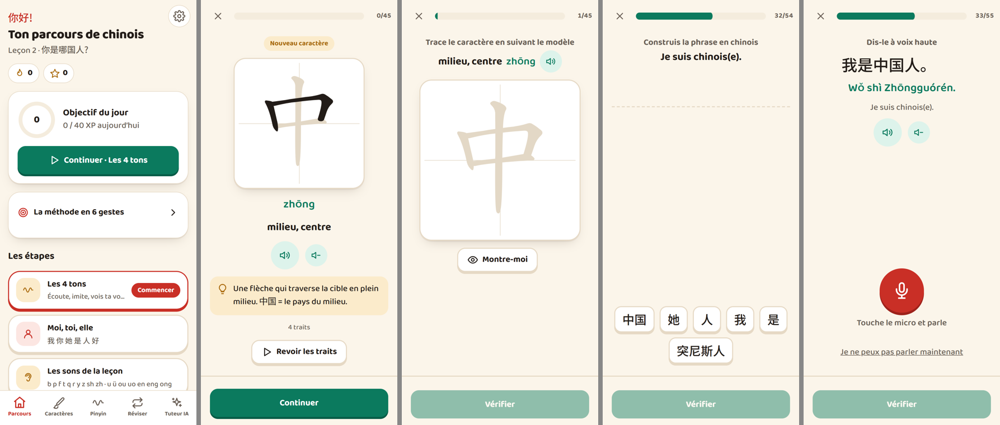
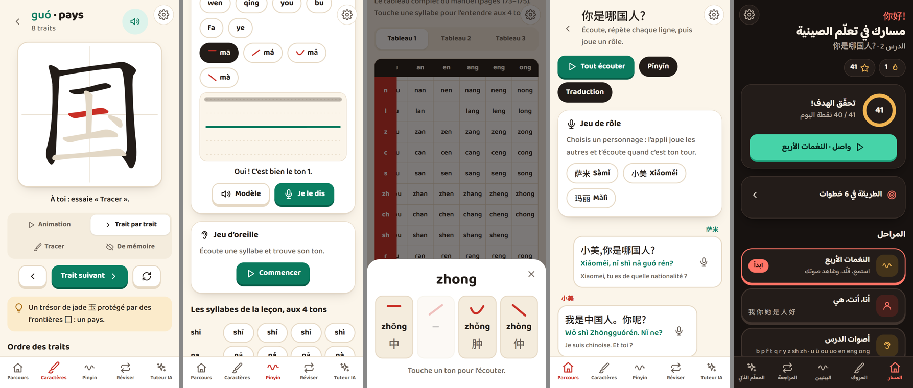
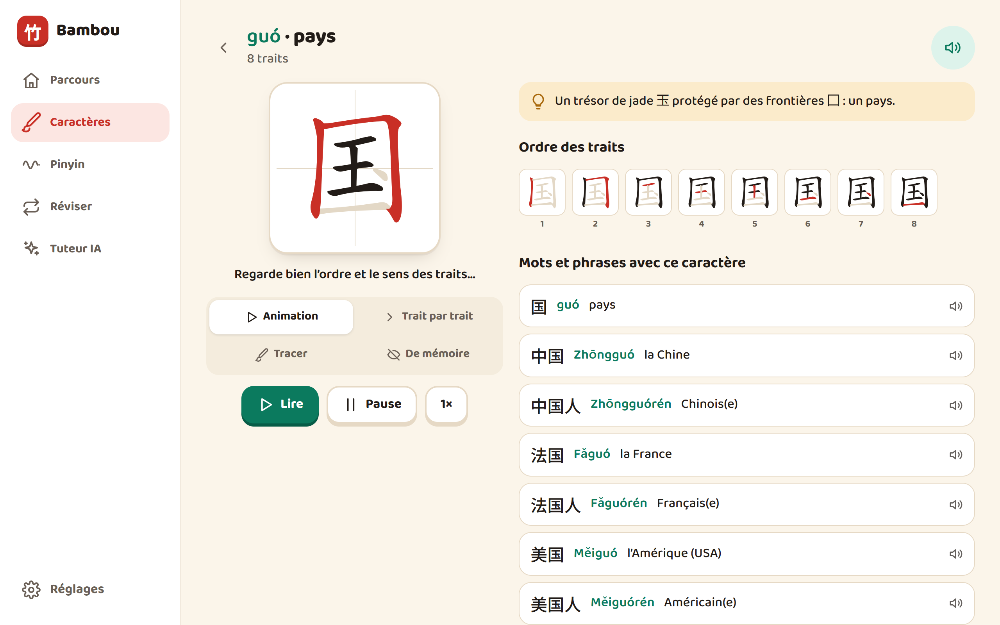
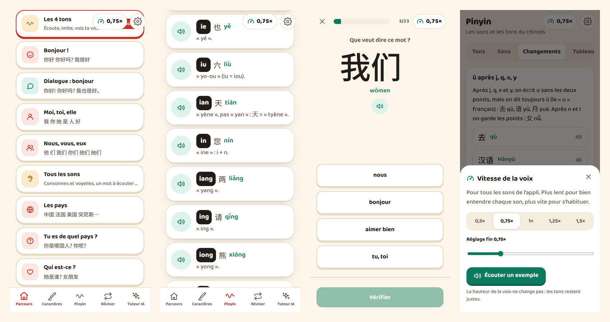

# Bambou 竹 — learn Chinese (lessons « 你好! » and « 你是哪国人? »)

A phone + PC web app to **read, write, pronounce and speak** beginner Chinese, built around
lessons 1 and 2 of the class, lesson 2 of the Tunisian 3rd-year secondary Chinese textbook
(pages 20–27) and its pinyin charts (pages 173–175). Interface in **Français · العربية · English**.

**Open it:** https://thefhiter.github.io/bambou-chinois/ — on a phone, use *Add to Home screen* to install it. After the first visit it also works offline.





## What's new — lessons 1 and 2 of the course, every sound, voice speed

- **6 new lessons and a dialogue** from what the class studied: *Bonjour !* (你好 你好吗 很),
  *Nous, vous, eux* (他 们 我们 你们 他们 她们), *Aller, aimer* (去 喜欢 爱 对 真),
  *Ravi de te connaître* (您 高兴 认识), *都, 不, 很 : la bonne place* (the six sentences 我很不高兴 …
  我们也不都很高兴) and *C'est quoi ?* (这 书 汉语 中文 姓 月) — 25 more characters to write (突 尼 斯 included).
- **Every sound of Chinese** (Pinyin → Sounds): 21 consonants and 37 vowels, each with how to say it for
  a French or Arabic speaker and a word to hear — ian is « yène », e is not « é », an/en keep their n,
  h is the خ, r is the French « j », k is an aspirated k (not خ)…
- **Tones that change**, four rules: ü after j q x y · 3ᵉ + 3ᵉ → 2ᵉ + 3ᵉ (not written) · 不 + 4ᵉ → bú (only
  不 and 一 do this) · the half 3rd tone (it stays low; it is not a 4th tone).
- **Voice speed** — one setting (0.5× to 1.5×, presets and a fine slider) for every sound of the app,
  reachable from every screen and from inside lessons. The pitch is kept, so the tones stay right.
- **One voice everywhere** — dialogue lines are now said by the voice the class chose by ear (clear
  « kh » for h, « j » for r), like every other word and sentence.



## The learning method

Every character and word goes through the same six moves:

| # | Move | In the app |
|---|------|-----------|
| 1 | **See** | The character draws itself stroke by stroke, with a memory picture (what its parts mean). |
| 2 | **Hear** | Recorded audio for every word and sentence, at normal and slow speed. Every clip's tone is measured before it ships (see *How the audio is checked*). |
| 3 | **Trace** | Write over the model with a finger or mouse; wrong strokes are rejected. |
| 4 | **Write from memory** | The model disappears. Too many slips and the character comes back later in the session. |
| 5 | **Say** | Speak into the microphone: the app compares your syllables and tones with the model. |
| 6 | **Review** | Spaced repetition — each item returns after 1, 2, 4, 8, 16, 32 days. |

## What is inside

- **Path** — 19 steps: tones → 你好 (+ dialogue) → 我你她是 → 我们你们他们 → every sound → countries → 你是哪国人 → 她是谁 → 叫什么名字 → tone changes → 请问/不/也/吗 → more countries → 去 喜欢 爱 → 您 高兴 认识 → 都/不/很 → 这是什么 → full dialogue → pinyin chart.
- **Lessons** — discover, trace, multiple choice, listen-and-pick, tone picking, grammar notes, sentence building, speaking, writing from memory. Mistakes are asked again before the session ends.
- **Characters** — 52 characters to write (animation, stroke-by-stroke steps, trace, from memory) and 18 to recognise.
- **Pinyin lab** — the 4 tones, a tone trainer that draws the pitch of your voice, an ear game, every consonant and vowel with a word to hear, tone changes (bú shì, half third tone, neutral tone), and the full pinyin chart with sound for every syllable.
- **Dialogues** — « 你好! » and « 你是哪国人? »: listen, repeat each line, or role-play as 萨米, 小美 or 玛丽.
- **Voice speed** — 0.5× to 1.5× for every clip, from any screen (the gauge button), pitch kept.
- **AI tutor (竹老师)** — a built-in coach that answers from the lesson offline, or Claude when an Anthropic API key is added in Settings.

## Microphone notes

- Speech checking uses the browser's speech recognition (Chrome, Edge, Android Chrome, Safari) and needs Internet. On other browsers the app records you and plays your voice next to the model so you can compare.
- The tone trainer works everywhere there is a microphone, offline too.
- The microphone only works on `https://` or `localhost`.

## How the audio is checked

The clips are synthesised (Microsoft Edge neural voice), and a synthetic voice does make mistakes.
So nothing is trusted by ear alone — the scripts in `tools/` measure every clip:

- **Tones.** `tonecheck.py` tracks the pitch of every single-syllable clip and checks that it draws the
  right tone (1st stays high, 2nd climbs, 3rd stays low, 4th drops). A clip that fails is recorded again
  another way — other punctuation, slower, inside a short phrase and cut out, or with another character
  that has the same reading — until it passes. All 1 190 chart clips and the lesson's one-character
  clips pass; 6 rare readings the voice cannot say correctly have no sound rather than a wrong one.
- **Textbook readings.** The voice says 哪 as *něi* (everyday speech); the textbook teaches *nǎ*, so the
  clips are recorded to say *nǎ*. 谁 is *shéi*, 什么 is *shénme*, as in the book.
- **Light syllables.** 吗, 呢 and 么 said alone are recorded lower and lighter, like the neutral tone they
  carry in a sentence, instead of sounding like a 1st or 4th tone.
- **Right reading.** Some characters have two readings (都 dōu/dū, 兴 xìng/xīng, 这 zhè/zhèi, 识 shí/shì…).
  `readcheck.py` records each one next to an unambiguous character for every reading: the voice gives
  *identical* audio for two characters it reads the same way, so the closest one is the reading it used.
  Result: all lesson characters are read as the book teaches except 兴 alone (read xīng) — its clip is
  recorded with 杏 (xìng, identical audio), like 哪 is recorded with 乸.
- **Right syllable.** `crosscheck.py` compares each chart clip with other characters that share its
  reading; if they do not sound the same, the clip is flagged and fixed.
- **Clean playback.** `polish_audio.py` cuts the silence around each clip (they used to end with up to
  1.3 s of dead air), adds short fades and brings every clip, in every voice, to the same loudness.

**Two voices.** Lesson words, sentences, dialogue lines and the example words of the sound chart use a male
voice the learners picked by ear because it says *h* as a clear "kh" (好 = *khao*) and *r* close to the
French "j" (人 = *jen*). Its pitch is too
low for `tonecheck.py` to follow, so those clips are used as recorded (trimmed and levelled only).
The pinyin chart keeps the female voice, where every clip is tone-checked.

## AI tutor

Settings → *AI tutor* → paste an Anthropic API key. The key is stored only in that browser and
sent only to `api.anthropic.com`. *Copy a link for my friends* creates a link that turns the tutor
on for whoever opens it — it contains the key, so share it only with people you trust.

## Run locally

```bash
python -m http.server 9116      # then open http://localhost:9116
```

No build step: plain HTML, CSS and ES modules.

## Project layout

```
index.html, sw.js, manifest.webmanifest
css/app.css          design tokens, light + dark, RTL
js/data.js           lesson content (fr / ar / en), the sound chart and tone rules
js/pinyin-table.js   the three pinyin charts
js/session.js        lesson + review engine
js/views.js          home, characters, pinyin lab, review, dialogue
js/tutor.js          AI tutor + offline coach
js/speech.js         speech scoring and pitch tracking
js/hanzi.js          stroke-order rendering
data/chars.json      stroke data for the lesson's characters
audio/               recorded clips (words, sentences, 1 196 pinyin syllables)
tools/               asset scripts (stroke data, audio + its checks, icons)
```

## Rebuilding assets

```bash
npm i hanzi-writer hanzi-writer-data pinyin-pro   # anywhere
node tools/build-assets.mjs path/to/node_modules  # vendor libs + data/chars.json + audio list
pip install edge-tts pypinyin numpy                # ffmpeg must be on the PATH
python tools/gen_audio.py                         # audio/: records what is missing, re-checks the rest
python tools/tonecheck.py                         # tone table for the chart clips (exit code 1 on a failure)
python tools/crosscheck.py                        # syllable check for the chart clips
python tools/readcheck.py                         # how the lesson voice reads characters with two readings
python tools/make_icons.py
```

After re-recording clips, bump `VERSION` in `sw.js` so installed copies fetch the new audio.

## Credits

Stroke data: [Hanzi Writer](https://hanziwriter.org) / Make Me a Hanzi (Arphic Public License).
Pinyin conversion: [pinyin-pro](https://github.com/zh-lx/pinyin-pro). Audio: Microsoft Edge neural voices.
